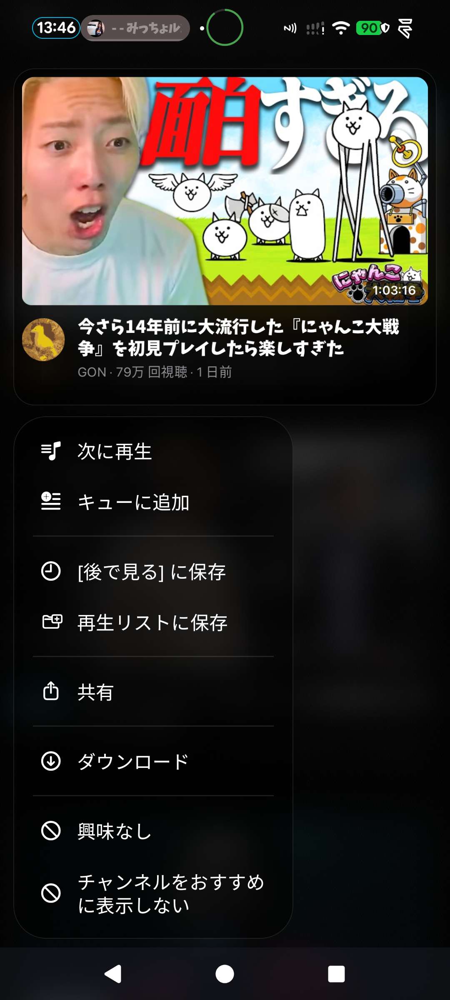
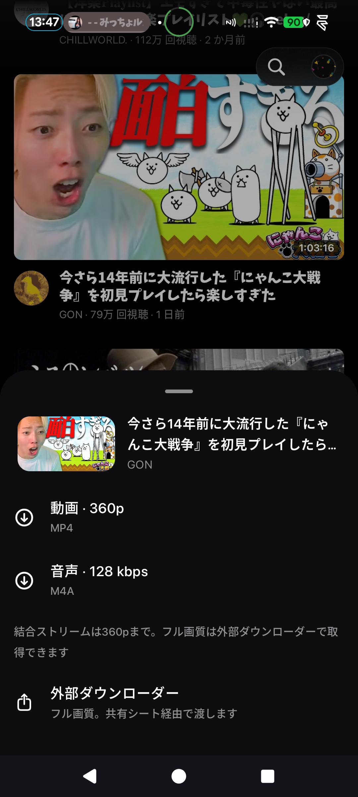
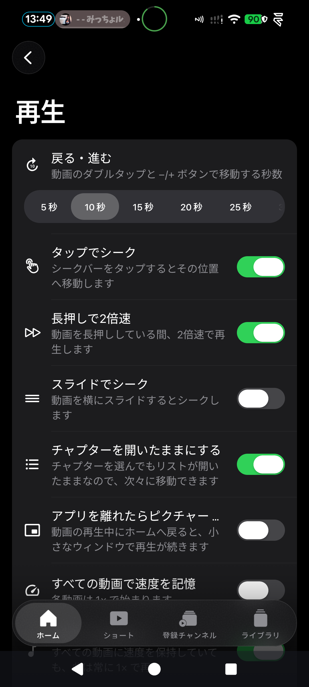
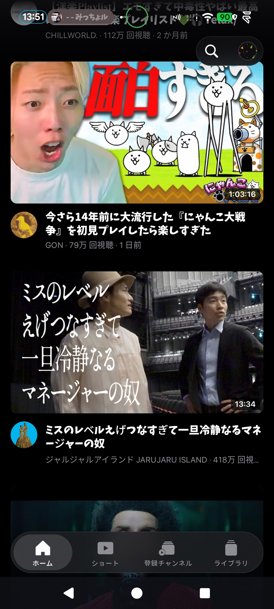
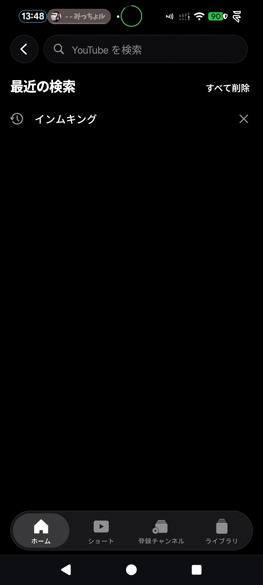
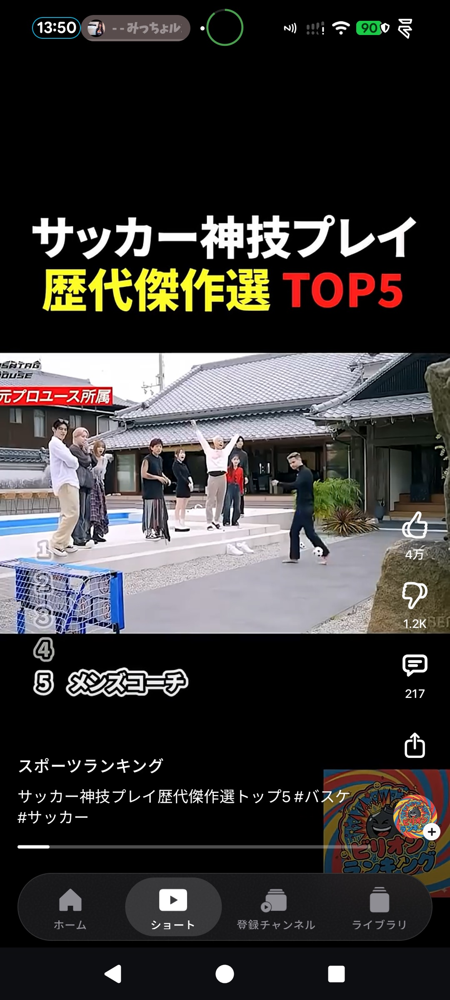

> ## About this fork
>
> This is a personal fork of [Yuno](https://github.com/danielkanan/Yuno) by Ren9618, created to experiment with and showcase additional features.
> It is **not an official release**: no APK is distributed from this repository and it is not supported.
>
> ### Added in this fork
> - **YouTube in the app's language** — a content-language setting that makes YouTube answer in the language the app runs in, so feed rows, chips, view counts, ages, descriptions and the player's related videos come back localized (Japanese verified on device).
> - **Multiple Google accounts and brand channels** — keep several Google accounts signed in side by side with quick switching, and act as one of the brand channels each account manages; the top bar, the account row and the comment composer then show the acting channel's photo and name.
> - **The Enhancements page** — Return YouTube Dislike on the like pill, DeArrow, the player's mute, loop and copy buttons, tracking-parameter-free share links, and a per-codec decoder policy, gathered on one settings page in five groups (extraction, community APIs, the player's own buttons, sharing, the decoder policy).
> - **An adjustable tab bar** — reorder, hide and show the bottom bar's tabs in Settings › Appearance › Tab bar (Home always stays).
> - **Empty states** — a feed that loads with no videos shows an empty state with a retry, and a signed-in Home with nothing of its own falls back to the guest recommendations for the session.
> - **Self-recovering bot check** — when YouTube's "confirm you're not a bot" refuses the streams, Yuno keeps waiting it out in the background (and again the moment the network changes), then opens the video by itself: the error panel needs no manual retry, and a video playing its 360p fallback swaps to the real streams.
> - **Signed-in extraction** — while signed in, the video's player requests ride the Google session the way yt-dlp uses cookies, so YouTube reads them as signed-in ones and the bot check rarely comes up at all (a toggle in Settings › Enhancements, on by default).
> - **Comment translation** — a Translate button under every comment turns it into the app's language, the original one tap away.
> - **The fork, labelled** — Settings › About shows this fork's own date-version with a build number (2026.11.18 (4)) and maintainer next to Yuno's, the maintainer's name opening their GitHub profile, and the player's Save / Playlist pills speak the app's language.
> - **Skip silence** — long quiet stretches in a video are fast-forwarded while it plays (a toggle in Settings › Playback, off by default).
> - **Shorts that speak the app's language** — the Shorts screen's chrome (Subscribe, Go to channel, Back, Comments, Share, the error notes) reads the string tables like the rest of the app.
> - **Shorts at their own ratio** — a short keeps its shape with black bars where the screen is wider, instead of being blown up to fill the screen (a toggle in Settings › Shorts).
> - **Quality per network** — a separate video-height ceiling for Wi-Fi and for mobile data, each overriding the player's own pick while the app rides that connection (Settings › Playback).
> - **Fullscreen side sliders, switchable** — the brightness and volume side drags on a fullscreen video can be turned off (Settings › Playback).
> - **Shorts counts, and dislike as "not interested"** — the Shorts rail shows like, dislike and comment counts (dislikes estimated by Return YouTube Dislike), and its dislike button is a real dislike to YouTube plus the channel's Shorts stop being offered on this device, skipping to the next short.
> - **The short's description** — a 「もっと見る」 (More) under the title opens the description text in place, TikTok-style, when YouTube sent one.
> - **Shorts gestures, chosen** — double-tap to like can be turned off, and pressing and holding a short plays it at 2× until the finger lifts (toggles in Settings › Shorts).
> - **Scrub gestures, chosen** — a tap on the progress bar seeks there, holding the video for 2× can be kept or turned off, and a horizontal slide on the video scrubs from where play is (toggles in Settings › Playback; the slide is off by default).
> - **Downloads** — a video's long-press menu and the quality pickers open a download sheet: the combined MP4 and the audio's M4A go through Android's Download Manager (its notification shows the progress; the file lands in Downloads), and an external-downloader row hands the cleaned link to an app like Seal, which isn't capped at 360p.
> - **Everything in the app's language** — the last hardcoded English is gone: the search page, the long-press menu, the player's notes and errors, the SponsorBlock pills, the quality/speed/chapters sheets, the queue, the account sheet's settings, the accessibility labels, and the onboarding all follow Japanese.
> - **Chapters, marked and tappable** — notches on the player's progress bar where a video's chapters change, the current chapter's name beside the time (tapping it opens the chapter list), and timestamps in the description that seek to their moment.
> - **Shorts autoplay** — a short that runs out starts the next one by itself, YouTube-style (a toggle in Settings › Shorts, off by default).
> - **Shorts picture-in-picture** — leaving the app while a short plays floats it in its own 9:16 window; the rail's PiP button enters it by hand and closing the window pauses the short (a toggle in Settings › Shorts, off by default).
> - **The author under the short** — a short's description ends with the channel's picture and name, opening the channel on its Videos tab.
> - **History's shorts** — Library › History shows Shorts in their own shelf beside the videos, and one tap plays the history's shorts in the Shorts player.
> - **Saved shorts** — a short's rail save button (held, the full save sheet) files it in YouTube's own 「保存したショート動画」 playlist, pinned in Library; a playlist of nothing but shorts plays in the Shorts pager (a toggle in Settings › Shorts decides, on by default).
>
> ### Technical notes
> - The content language rides through the InnerTube requests (`hl`/`gl`), so YouTube answers with localized strings the existing parsers read; counts and ages fall back to a locale-aware number parser when YouTube answers in Japanese.
> - Each Google account is its own cookie session kept AES-GCM encrypted; switching swaps the active session, and a brand channel rides its account's session under the channel's identity.
> - The signed-in extraction sends the session's cookies and the SAPISIDHASH signature youtube.com's own pages sign with, and the web origin follows the request's own host — YouTube rejects a web origin on the wrong host with "Origin doesn't match Host". Only the player requests ride it; feeds, search and comments stay anonymous.
> - The codec policy filters video streams before playback picks one, and a debug-only DecoderTestActivity exercises every MediaCodec on a device.
> - Full notes: [docs/fork-notes-enhancements.md](docs/fork-notes-enhancements.md)
>
> 
>
> |  |  |  |
> |---|---|---|
> | The long-press menu, in Japanese, with its new **ダウンロード** (Download) row | The download sheet: the combined MP4, the audio's M4A, or the **外部ダウンローダー** (external downloader) row for full quality | The three scrub gestures, each with its own toggle (the slide is off by default) |
>
> Upstream: https://github.com/danielkanan/Yuno (GPL-3.0 — see LICENSE and Credits below) — merged through its Yuno 1.1.1 (channel tabs, Flow-style search, livestreams, playlist pages, letterboxing, the morphing player); the fork's features ride on top, and the new screens are translated into Japanese.

<div align="center">

<br/>
<br/>


<hr />

### An ad-free YouTube player for Android

<br/>

[](https://github.com/danielkanan/Yuno/releases)
[](https://github.com/danielkanan/Yuno/blob/main/LICENSE)
[](https://github.com/danielkanan/Yuno/releases)

<br/>

[**Download**](#download) · [**Features**](#features) · [**Building**](#building) · [**Disclaimer**](#disclaimer)

<br/>

</div>

> [!IMPORTANT]
> Yuno is not affiliated with, endorsed by, or connected to YouTube or Google in any way. Use it at your own discretion.

---

<div align="center">

<table width="100%">
  <tr>
    <td width="33%"></td>
    <td width="33%"></td>
    <td width="33%"></td>
  </tr>
</table>

<h1><a id="features"></a>Features</h1>

<table>
  <tr>
    <td width="50%" valign="top">

#### Playback
- **Search and play** YouTube with no sign-in required.
- **Up to 1080p** — video and audio as separate streams, merged through generated DASH manifests (avoids YouTube throttling).
- **Player controls on the video:** ±10 s skip, draggable scrubber, chapters and SponsorBlock marks, quality and captions; controls auto-hide after 2 s.
- **Mini-player morph** — swipe the player down to minimize (it follows your finger) or swipe the mini-player up to expand; live video in the mini-player.
- **Background audio** with a media notification.
- **Queue** — long-press any video for Play next / Add to queue.
- **Playback speed** (0.5×–3×, optional “remember for every video”) and **audio-only** mode.
- **SponsorBlock** — per category Skip / Ask / Show / Off, with audio-fade skips and Undo.
- **Enhancements page** — Return YouTube Dislike on the like pill, DeArrow, the player's mute, loop and copy buttons, tracking-parameter-free share links, and a per-codec decoder policy. *(added in this fork)*
- **Self-recovering bot check** — when YouTube's "confirm you're not a bot" check blocks the streams, Yuno keeps trying in the background and retries the moment the network changes, then opens the video by itself. *(added in this fork)*
- **Skip silence** — long quiet stretches in a video are fast-forwarded while it plays. *(added in this fork)*
- **Chapters on the bar** — notches where a video's chapters change, the chapter's name by the time row, and description timestamps that seek. *(added in this fork)*

#### Player bar
- While a video is open, the tab bar becomes the **player bar** (−10 · play · +10 · tools): quality, PiP, fullscreen, speed, chapters, and scrub with storyboard preview.

    </td>
    <td width="50%" valign="top">

#### Shorts & feeds
- **YouTube in the app's language** — a content-language setting that makes YouTube answer in the language the app runs in: feed rows, chips, view counts, ages and descriptions come back localized. *(added in this fork)*
- **Tab bar you can arrange** — reorder, hide and show the bottom bar's tabs in Settings › Appearance › Tab bar; Home always stays in it. *(added in this fork)*
- **Empty states** — a feed that loads with no videos shows an empty state with a retry, and a signed-in Home with nothing of its own falls back to the guest recommendations for the session. *(added in this fork)*
- **Shorts tab** — vertical feed (personalized when signed in). Frosted-glass bar with Like, Comments, Share, and channel subscribe.
- **Shorts bank** — the next 10 unseen shorts are cached on disk (~100–150 MB) so they start instantly; seen shorts are forgotten and refilled in the background.
- **Shorts autoplay & picture-in-picture** — a short that ends starts the next one by itself, and leaving the app floats the playing short in its own window (the rail's PiP button enters by hand). *(added in this fork)*
- **Saved shorts** — the rail's save button fills YouTube's own 「保存したショート動画」 playlist, history shows its shorts in their own shelf, and shorts-only playlists play in the Shorts pager. *(added in this fork)*
- **Home & Subscriptions** when signed in; **Library** for history, playlists, Watch later, and liked videos.

#### Account & community
- **Optional Google sign-in** — full sync: recommendations, subscriptions, history, likes, subscribes, Save, Watch later, watch history, and **comment/reply posting**.
- **Multiple Google accounts and brand channels** — keep several Google accounts signed in side by side with quick switching, and act as one of the brand channels each account manages; the top bar then shows the acting channel's photo and name. *(added in this fork)*
- Session cookies stored **AES-GCM encrypted** (Android Keystore).
- **Comments** with avatars, replies, and likes (signed in).
- **Comment translation** — a Translate button under every comment turns it into the app's language, the original one tap away. *(added in this fork)*
- **Self-update** from GitHub releases when a newer APK is published.

    </td>
  </tr>
</table>

</div>

---

<div align="center">

<h1><a id="download"></a>Download</h1>

**[Yuno.apk](https://github.com/danielkanan/Yuno/releases/latest/download/Yuno.apk)** — latest release. Open it on your phone and allow installs from your browser; updates install over the previous build.

Publishing: bump `versionName` / `versionCode` in `app/build.gradle.kts`, then run `scripts/publish-apk.sh`.

</div>

---

<div align="center">

<h1><a id="building"></a>Building</h1>

Android SDK (compileSdk 36) and a JDK 21 (e.g. [Temurin 21](https://adoptium.net)). Note: Android
Studio's bundled JBR 25 **crashes** this Gradle (8.11.1) — its build-script compiler (Kotlin 2.0.20)
can't parse a Java "25.0.3" version string — so point Gradle at a JDK 21 instead:

```sh
# ~/.gradle/gradle.properties  (macOS example; adjust to your install)
org.gradle.java.home=/Library/Java/JavaVirtualMachines/temurin-21.jdk/Contents/Home

./gradlew assembleDebug      # app/build/outputs/apk/debug/app-debug.apk
./gradlew assembleRelease    # R8-shrunk, debug-signed — judge feel on this build
./gradlew testDebugUnitTest  # InnerTube / parser tests
adb install -r app/build/outputs/apk/release/app-release.apk
```

Both builds are debug-signed; the repository ships no release keystore. Key paths:
`app/src/main/java/com/yuno/` (player, feeds, Shorts, service; the fork's extras live beside them,
`Fork.kt` / `Enhancers.kt` / `Account.kt` / `ContentLanguage.kt`).

</div>

---

<div align="center">

<h2>Credits</h2>

- [NewPipeExtractor](https://github.com/TeamNewPipe/NewPipeExtractor): YouTube data, GPL-3.0
- [AndroidX Media3](https://github.com/androidx/media): playback
- [SponsorBlock](https://sponsor.ajay.app): sponsor segments, CC BY-NC-SA 4.0 (planned)
- [essopsp](https://github.com/essopsp): the idea of a Shorts tab ([#10](https://github.com/deciocrytek/Skipii/pull/10))
- [@o0ir4](https://www.threads.com/@o0ir4): reported the layout on Arabic (right-to-left) phones (0.5.64)
- [nsk-47](https://github.com/nsk-47): found the gap under Appearance on large font sizes ([#24](https://github.com/deciocrytek/Skipii/issues/24), 0.5.65); the fullscreen quality sheet covering the video ([#25](https://github.com/deciocrytek/Skipii/issues/25)) and wider thumbnails ([#27](https://github.com/deciocrytek/Skipii/issues/27)), 0.5.68
- [BaooRaami](https://github.com/BaooRaami): controls on the video ([#28](https://github.com/deciocrytek/Skipii/issues/28)) and the cut-off channel line on feed cards ([#27](https://github.com/deciocrytek/Skipii/issues/27)), 0.5.68
- [usa2525-code](https://github.com/usa2525-code): the What's new sheet before updating ([#30](https://github.com/deciocrytek/Skipii/issues/30)), 0.5.68

<h1><a id="disclaimer"></a>Disclaimer</h1>

Yuno is an independent, sideloaded **YouTube player**. It is **not** associated with Google LLC, YouTube, or any of their services. It is not distributed through the Play Store.

* **No hosting:** Yuno does not host videos; it plays streams from YouTube via [NewPipeExtractor](https://github.com/TeamNewPipe/NewPipeExtractor).
* **Your responsibility:** Use aligns with YouTube’s Terms of Service and your local laws. Google may suspend accounts used with unofficial clients.
* **SponsorBlock** data is CC BY-NC-SA 4.0 ([SponsorBlock](https://sponsor.ajay.app)); non-commercial use only.
* **Copyleft:** GPL-3.0 (required by NewPipeExtractor). See [LICENSE](LICENSE).

</div>

---

<div align="center">

<h1><a id="license"></a>License</h1>

This project is licensed under the **GNU General Public License v3.0 (GPLv3)**. See [LICENSE](LICENSE).

</div>
