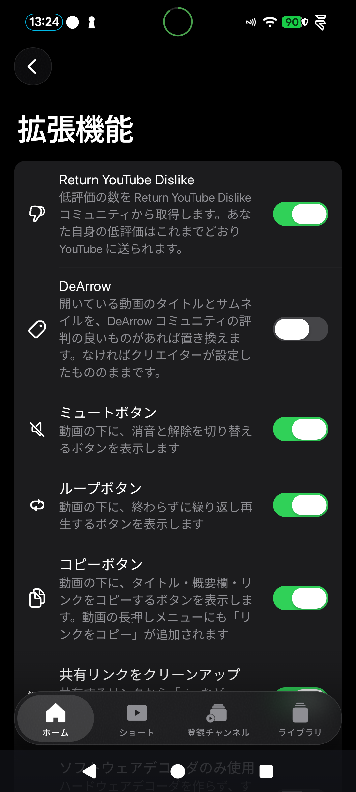

> ## About this fork
>
> This is a personal fork of [Yuno](https://github.com/danielkanan/Yuno) by Ren9618, created to experiment with and showcase additional features.
> It is **not an official release**: no APK is distributed from this repository and it is not supported.
>
> ### Added in this fork
> - **YouTube in the app's language** — a content-language setting that makes YouTube answer in the language the app runs in, so feed rows, chips, view counts, ages and descriptions come back localized (Japanese verified on device).
> - **Multiple Google accounts and brand channels** — keep several Google accounts signed in side by side with quick switching, and act as one of the brand channels each account manages.
> - **The Enhancements page** — Return YouTube Dislike on the like pill, DeArrow, the player's mute, loop and copy buttons, tracking-parameter-free share links, and a per-codec decoder policy, gathered on one settings page.
> - **An adjustable tab bar** — reorder, hide and show the bottom bar's tabs in Settings › Appearance › Tab bar (Home always stays).
> - **Empty states** — a feed that loads with no videos shows an empty state with a retry, and a signed-in Home with nothing of its own falls back to the guest recommendations for the session.
> - **Self-recovering bot check** — when YouTube's "confirm you're not a bot" refuses the streams, Yuno keeps waiting it out in the background (and again the moment the network changes), then opens the video by itself: the error panel needs no manual retry, and a video playing its 360p fallback swaps to the real streams.
>
> ### Technical notes
> - The content language rides through the InnerTube requests (`hl`/`gl`), so YouTube answers with localized strings the existing parsers read; counts and ages fall back to a locale-aware number parser when YouTube answers in Japanese.
> - Each Google account is its own cookie session kept AES-GCM encrypted; switching swaps the active session, and a brand channel rides its account's session under the channel's identity.
> - The codec policy filters video streams before playback picks one, and a debug-only DecoderTestActivity exercises every MediaCodec on a device.
> - Full notes: [docs/fork-notes-enhancements.md](docs/fork-notes-enhancements.md)
>
> 
>
> Upstream: https://github.com/danielkanan/Yuno (GPL-3.0 — see LICENSE and Credits below)

<div align="center">

<br/>
<br/>


<hr />

### An ad-free YouTube player for Android

<br/>

[](https://github.com/danielkanan/Yuno/releases)
[](https://github.com/danielkanan/Yuno/blob/main/LICENSE)
[](https://github.com/danielkanan/Yuno/releases)

<br/>

[**Download**](#download) · [**Features**](#features) · [**Building**](#building) · [**Disclaimer**](#disclaimer)

<br/>

</div>

> [!IMPORTANT]
> Yuno is not affiliated with, endorsed by, or connected to YouTube or Google in any way. Use it at your own discretion.

---

<div align="center">

<table width="100%">
  <tr>
    <td width="33%"></td>
    <td width="33%"></td>
    <td width="33%"></td>
  </tr>
</table>

<h1><a id="features"></a>Features</h1>

<table>
  <tr>
    <td width="50%" valign="top">

#### Playback
- **Search and play** YouTube with no sign-in required.
- **Up to 1080p** — video and audio as separate streams, merged through generated DASH manifests (avoids YouTube throttling).
- **Player controls on the video:** ±10 s skip, draggable scrubber, chapters and SponsorBlock marks, quality and captions; controls auto-hide after 2 s.
- **Mini-player morph** — swipe the player down to minimize (it follows your finger) or swipe the mini-player up to expand; live video in the mini-player.
- **Background audio** with a media notification.
- **Queue** — long-press any video for Play next / Add to queue.
- **Playback speed** (0.5×–3×, optional “remember for every video”) and **audio-only** mode.
- **SponsorBlock** — per category Skip / Ask / Show / Off, with audio-fade skips and Undo.
- **Enhancements page** — Return YouTube Dislike on the like pill, DeArrow, the player's mute, loop and copy buttons, tracking-parameter-free share links, and a per-codec decoder policy. *(added in this fork)*
- **Self-recovering bot check** — when YouTube's "confirm you're not a bot" check blocks the streams, Yuno keeps trying in the background and retries the moment the network changes, then opens the video by itself. *(added in this fork)*

#### Player bar
- While a video is open, the tab bar becomes the **player bar** (−10 · play · +10 · tools): quality, PiP, fullscreen, speed, chapters, and scrub with storyboard preview.

    </td>
    <td width="50%" valign="top">

#### Shorts & feeds
- **YouTube in the app's language** — a content-language setting that makes YouTube answer in the language the app runs in: feed rows, chips, view counts, ages and descriptions come back localized. *(added in this fork)*
- **Tab bar you can arrange** — reorder, hide and show the bottom bar's tabs in Settings › Appearance › Tab bar; Home always stays in it. *(added in this fork)*
- **Empty states** — a feed that loads with no videos shows an empty state with a retry, and a signed-in Home with nothing of its own falls back to the guest recommendations for the session. *(added in this fork)*
- **Shorts tab** — vertical feed (personalized when signed in). Frosted-glass bar with Like, Comments, Share, and channel subscribe.
- **Shorts bank** — the next 10 unseen shorts are cached on disk (~100–150 MB) so they start instantly; seen shorts are forgotten and refilled in the background.
- **Home & Subscriptions** when signed in; **Library** for history, playlists, Watch later, and liked videos.

#### Account & community
- **Optional Google sign-in** — full sync: recommendations, subscriptions, history, likes, subscribes, Save, Watch later, watch history, and **comment/reply posting**.
- **Multiple Google accounts and brand channels** — keep several Google accounts signed in side by side with quick switching, and act as one of the brand channels each account manages. *(added in this fork)*
- Session cookies stored **AES-GCM encrypted** (Android Keystore).
- **Comments** with avatars, replies, and likes (signed in).
- **Self-update** from GitHub releases when a newer APK is published.

    </td>
  </tr>
</table>

</div>

---

<div align="center">

<h1><a id="download"></a>Download</h1>

**[Yuno.apk](https://github.com/danielkanan/Yuno/releases/latest/download/Yuno.apk)** — latest release. Open it on your phone and allow installs from your browser; updates install over the previous build.

Publishing: bump `versionName` / `versionCode` in `app/build.gradle.kts`, then run `scripts/publish-apk.sh`.

</div>

---

<div align="center">

<h1><a id="building"></a>Building</h1>

Android SDK (compileSdk 36) and JDK 17+. Android Studio’s bundled JDK works:

```sh
export JAVA_HOME="/Applications/Android Studio.app/Contents/jbr/Contents/Home"
./gradlew assembleDebug      # app/build/outputs/apk/debug/app-debug.apk
./gradlew assembleRelease    # R8-shrunk, debug-signed — judge feel on this build
./gradlew testDebugUnitTest  # InnerTube / parser tests
```

Key paths: `app/src/main/java/com/yuno/` (player, feeds, Shorts, service).

</div>

---

<div align="center">

<h2>Credits</h2>

- [NewPipeExtractor](https://github.com/TeamNewPipe/NewPipeExtractor): YouTube data, GPL-3.0
- [AndroidX Media3](https://github.com/androidx/media): playback
- [SponsorBlock](https://sponsor.ajay.app): sponsor segments, CC BY-NC-SA 4.0 (planned)
- [essopsp](https://github.com/essopsp): the idea of a Shorts tab ([#10](https://github.com/deciocrytek/Skipii/pull/10))
- [@o0ir4](https://www.threads.com/@o0ir4): reported the layout on Arabic (right-to-left) phones (0.5.64)
- [nsk-47](https://github.com/nsk-47): found the gap under Appearance on large font sizes ([#24](https://github.com/deciocrytek/Skipii/issues/24), 0.5.65); the fullscreen quality sheet covering the video ([#25](https://github.com/deciocrytek/Skipii/issues/25)) and wider thumbnails ([#27](https://github.com/deciocrytek/Skipii/issues/27)), 0.5.68
- [BaooRaami](https://github.com/BaooRaami): controls on the video ([#28](https://github.com/deciocrytek/Skipii/issues/28)) and the cut-off channel line on feed cards ([#27](https://github.com/deciocrytek/Skipii/issues/27)), 0.5.68
- [usa2525-code](https://github.com/usa2525-code): the What's new sheet before updating ([#30](https://github.com/deciocrytek/Skipii/issues/30)), 0.5.68

<h1><a id="disclaimer"></a>Disclaimer</h1>

Yuno is an independent, sideloaded **YouTube player**. It is **not** associated with Google LLC, YouTube, or any of their services. It is not distributed through the Play Store.

* **No hosting:** Yuno does not host videos; it plays streams from YouTube via [NewPipeExtractor](https://github.com/TeamNewPipe/NewPipeExtractor).
* **Your responsibility:** Use aligns with YouTube’s Terms of Service and your local laws. Google may suspend accounts used with unofficial clients.
* **SponsorBlock** data is CC BY-NC-SA 4.0 ([SponsorBlock](https://sponsor.ajay.app)); non-commercial use only.
* **Copyleft:** GPL-3.0 (required by NewPipeExtractor). See [LICENSE](LICENSE).

</div>

---

<div align="center">

<h1><a id="license"></a>License</h1>

This project is licensed under the **GNU General Public License v3.0 (GPLv3)**. See [LICENSE](LICENSE).

</div>
