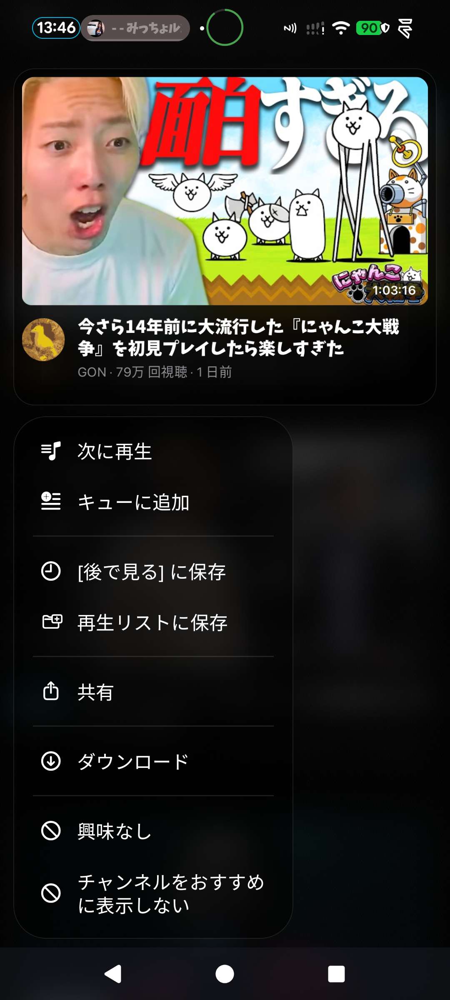
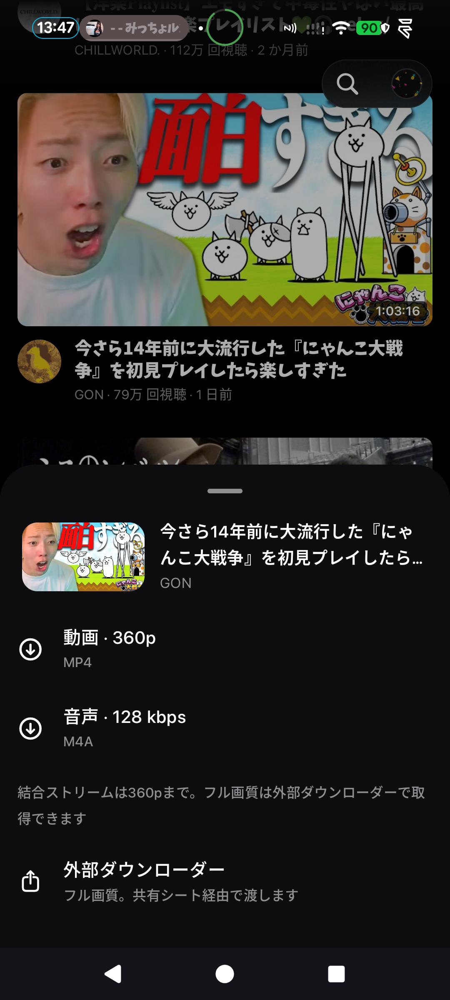
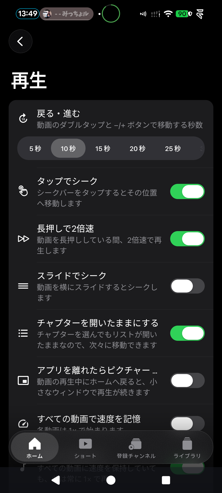
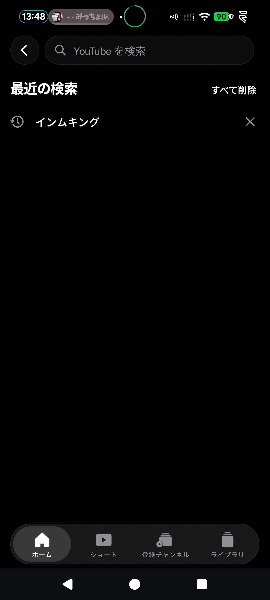

# Fork notes: enhancements

Notes on the changes this fork adds on top of upstream Yuno, written from the actual diff and the verification run.

## Overview

The fork adds twenty user-facing things: a content-language setting that makes YouTube answer in the app's language (Japanese verified on a device), multi-account Google sign-in with brand channels, an **Enhancements** settings page that gathers community extras (Return YouTube Dislike, DeArrow, mute / loop / copy buttons, link sanitizing) and a per-codec decoder policy, a reorderable bottom tab bar, empty states for feeds that load with no videos, a bot check that recovers by itself, a skip-silence toggle that fast-forwards a video's long quiet stretches while it plays, a signed-in session the player requests ride so the bot check rarely comes up at all, comment translations in the app's language, and the fork's own version and maintainer in About. A second batch turns to the Shorts screen and the player's edges: the Shorts chrome in the app's language, Shorts at their own ratio instead of blown up to fill the screen, video-quality ceilings per connection (Wi-Fi and mobile data), the fullscreen brightness/volume side drags made switchable, like/dislike/comment counts on the Shorts rail with the dislike doubling as YouTube's 「興味ない」 (the channel's Shorts stop being offered on the device), the short's description behind a 「もっと見る」, Shorts gestures made choosable (double-tap like off; hold for 2×), and the Enhancements page grouped into five sections. A third batch takes the video's own handling in hand: the scrub gestures made choosable (a tap on the bar seeks, the hold for 2× can be kept or turned off, and a horizontal slide on the video scrubs), and saving a video's own file — the combined MP4 or the audio's M4A through Android's Download Manager, with an external downloader as the way to full quality. The goal is to make the player feel native in Japanese and to expose community features YouTube itself does not offer, without touching upstream's identity, licensing or release flow.

## How it works

One commit per feature, all on `feat/enhancements`:

- **`529497f` feat: ask YouTube in the app's language** — new `ContentLanguage.kt` carries `hl`/`gl` through the InnerTube requests, so YouTube answers with localized strings that the existing parsers read unchanged. `YouTube.kt` parses the localized counts and ages, and `UiKit.kt` formats counts, likes and ages per locale (Japanese 万/億 handling, `JapaneseParseTest.kt` covers the parse). The picker lives in Settings › Language › YouTube content (`ContentLanguageBody` in `Settings.kt`).
- **`2df371f` feat: support multiple Google accounts and brand channels** — `Account.kt` keeps several Google cookie sessions side by side (each AES-GCM encrypted as before), switches the active one, and lets an account act as one of the brand channels it manages. `Settings.kt` renders the accounts page (Google accounts, Add account, Channels: personal / brand). A subtitle without a handle now shows its fallback name instead of a literal "null".
- **`e0d6cfd` feat: add the Enhancements page** — new `Enhancers.kt` (toggles + `Enhancers.link()` tracking-parameter stripping, plus the Return YouTube Dislike and DeArrow clients) and new `Codecs.kt` (`CodecSettings`: disable a codec entirely, run decoders software-only, or use the synchronous MediaCodec adapter). `Settings.kt` gets the Enhancements page; `PlayerState.kt` persists mute/loop, `PlayerUi.kt` draws the mute, loop and copy pills and the dislike count, `Sheets.kt` copies links via the clipboard, `YouTube.kt` filters stream candidates through the codec policy before quality picks one, `PlaybackService.kt` falls back to sound when every video codec is off, and `AvSync.kt` holds the synchronous adapter path. A debug-only `DecoderTestActivity` exercises every MediaCodec on the device.
- **`a95bed7` feat: let the bottom bar's tabs be reordered, hidden and shown** — new `NavTabs.kt` stores the tab order and hidden set as one string in the "playback" preferences (`Home,-Shorts,Subscriptions,Library` style); `shown()` also drops Shorts while its master switch is off. `Settings.kt` edits both under Appearance › Tab bar, and `MainActivity.kt`, `NavBar.kt`, `GlassNav.kt` and `Rail.kt` all follow it. `Tab` carries its label as a resource so the bar reads in the app's language.
- **`39d09ab` fix: show empty feeds with an empty state and guest picks** — `Feeds.kt` shows an empty state with a retry when a feed loads with no videos, and a signed-in Home that comes back empty falls back to the guest recommendations for the session (stuck, undone by a feed/account reset, so the fallback keeps paging itself).
- **`a6cf3c9` fix: wait out YouTube's bot check and recover on its own** — new `BotCheckRecovery.kt` keeps quietly re-loading a refused video after the quick retries give up (`BotCheck`: 3 s / 8 s / 20 s and then either a 360p fallback or the error panel): stretches of 30 s / 60 s / 120 s / 240 s, and again the moment the default network changes — the check rides on the address, which is what the panel's airplane-mode hint is about. When a background load finally comes back with the real streams, `PlayerState.onBotCheckRecovered` opens the video stuck on the error panel again (the cache now holds the real streams), and the service's `StreamRecoverer.onRecovered` swaps a playing 360p fallback's source in place, at the same position. A wait that runs out its tries re-arms once more on the next network change (for ten minutes), so the toggle the panel suggests keeps working by itself. `VideoView`'s error panel states the auto-retry under the hint and adds an airplane-mode settings button; the loading spinner's bot-check note is localized now.
- **`6ac55db` feat: skip silence while a video plays** — new `SkipSilence` in `PlaybackModes.kt`, one kept switch in the "playback" preferences (off by default). It's a setting on ExoPlayer itself, which the UI's MediaController can't reach, so `PlaybackService.onCreate` applies it — `player.skipSilenceEnabled = SkipSilence.on` when the player starts — and follows changes through a `SkipSilence.onChanged` callback while the service lives (`onDestroy` clears it). The row sits in Settings › Playback under the audio-only one (waveform icon, `SkipSilence.set` only — no player state involved). The skipping itself is ExoPlayer's built-in silence skipping: `DefaultAudioSink`'s default processor chain carries `SilenceSkippingAudioProcessor`, and the app's `SyncedRenderersFactory` passes that sink to `MediaCodecAudioRenderer` untouched, so the flag lands.
- **`8fda240` feat: ride the signed-in session through the player requests** — new `SessionExtraction.kt` signs the extractor's player requests with the signed-in Google session, the way yt-dlp uses cookies: the session's cookies, the SAPISIDHASH signature `Account.authorization` already makes for youtube.com's own pages, and the web origin of the request's own host (a www origin on the googleapis reel request is YouTube's "Origin doesn't match Host" 400, so each host signs itself, as yt-dlp derives its origin from the API host). The scope is the player requests only — the extractor's reel request (ANDROID's details), both VISIONOS player calls (the extractor's own and `PlayerFallback`'s stand-in, which now tries the session first and falls back to its anonymous ask) — while feeds, search and comments stay anonymous; a session YouTube won't take (4xx) retries the request anonymously once, so playback never breaks, and the refusal body is logged for diagnosis. The switch leads Settings › Enhancements (`Enhancers.sessionExtraction`, on by default, "Use the signed-in session for extraction"; turning it invalidates the stream cache), and `NewPipeDownloader.execute` carries the injection.
- **`035437d` feat: say Save and Playlist in the app's language** — the player's Save / Playlist pills were the only UI chrome left in English (the rest of the app already reads its string tables): `PlayerUi`'s `AccountActions` now labels every pill and its accessibility description through the resources — 保存 / 保存済み, 再生リスト, 高く評価 / 低く評価 — with one new short string (`player_save`); the rest rode translations that were already there.
- **`9c77d3f` feat: translate comments into the app's language** — new `Translate.kt` (`Translator`): Google Translate's public web endpoint (`translate_a/single?client=gtx` — the same one community tools use; no key, no account, and the comments are public anyway), asked in the app's language (`AppLanguage.locale`). `CommentsState.toggleTranslation` fetches a comment once (cached while the video's comments stay open; a failed fetch retries on the next tap) and `CommentRow` gains a Translate button next to Reply: the answer sits under the original with the detected source language named in the app's language («英語から翻訳»), and the button folds it back («原文を表示»). Translations clear with the video's comments, like the replies do. `TranslateTest` covers the gtx answer shape.
- **`ca3686f` feat: show the fork's version and maintainer in About** — new `Fork.kt` (`VERSION` is the fork's state date, `AUTHOR`, `URL`) and one row in Settings › About under the source-code row: "このフォーク — バージョン 2026.11.16 · メンテナー Ren9618 …", which opens the fork's own repository. Yuno's version row above stays upstream's.
- **`2bbb605` feat: say the Shorts chrome in the app's language** — the Shorts screen was the last place still speaking hardcoded English: every literal in `Shorts.kt` (Subscribe / Unsubscribe, Go to channel, Back, Channel, Comments, Share, Like, the sign-in prompt, the error and empty-feed notes, Try again) now reads the string tables like the rest of the app. Every one rode a translation that was already there except `shorts_subscribed` — the ✓ badge on the channel card's avatar — which is new.
- **`23b8458` feat: show Shorts at their own ratio** — new `ShortsRatio` object in `Shorts.kt` keeps one switch in the "playback" preferences (`shorts_original_ratio`, on by default), and the page's video sizing only blows up to fill the screen (`cover`) while it's off (`!wide && aspect < 0.7f && !ShortsRatio.original`): a short plays at its own aspect with black bars where the screen is wider. The toggle sits in Settings › Shorts.
- **`ec1b351` feat: let the fullscreen side sliders be turned off** — new `SideSliders` object beside the fullscreen gestures in `FullscreenSliders.kt` (one kept switch, on by default). When off, the gesture's side zone only swallows the drag — brightness and volume stay put, and nothing pulls the seek row or leaves fullscreen because of it. The toggle sits in Settings › Playback.
- **`d7c8fea` feat: shorts double-tap like off and hold-to-2x** — new `ShortsGestures` object (two kept switches, both on). `ShortsState.shortTaps` is rewritten as an honest race: the down waits `withTimeoutOrNull(longPressTimeoutMillis)` for the up, and whichever comes first wins — an up (no past-slop travel, no control such as a rail button or the scrub line having consumed the touch) is a tap, counted into the double-tap run while `shorts_double_tap_like` is on; the timeout is the hold, which `beginHoldFast` answers with `PlaybackParameters(2f)` and a 「2×」 pill while it runs, and `endHoldFast` returns to 1× the moment the finger lifts. With double-tap off, taps do nothing.
- **`dd1dcdc` feat: set the quality per network** — new `NetworkQuality.kt`: a video-height ceiling for Wi-Fi and one for mobile data, kept in the "playback" preferences (`quality_wifi` / `quality_mobile`, 0 = Auto). The kind comes from `ConnectivityManager` when a stream set is chosen — Ethernet rides Wi-Fi, and a connection whose transports Android won't say (a VPN) counts as the careful mobile side — so `StreamSelection.pick` feeds `NetworkQuality.effective(QualityPreference.height)` where the global height used to go, and `PlaybackService` decides adaptive-vs-pinned with the per-network ceiling too. Two pickers sit in Settings › Playback (Auto + 480/720/1080/1440/2160p). `NetworkQualityTest` covers `effective()` without a device.
- **`33c7c44` feat: open a short's description with More** — when the short's description has words, 「もっと見る」 (More) shows under the title and folds the text open and closed in place, TikTok-style (state remembered per short id, 「折りたたむ」 while open). Shorts that came out of the bank carried stub details with an empty description, so `markShown` refetches the real details the moment a banked short comes on screen (`YouTube.details(id, wait = false)`).
- **`570caea` feat: shorts like, dislike and comment counts, and dislike as not interested** — the Shorts rail gains the dislike button and counts: `markShown` fetches Return YouTube Dislike's votes for the short on screen (likes real, dislikes estimated) and reads the comment total from the comments' first page the existing prefetch already started, and `RailCount` shows both by the buttons. The dislike tap is YouTube's 「興味ない」 twice over: a real dislike to YouTube (`InnerTube.setLike(id, Dislike)`; tapping it again takes the dislike back), plus `ShortsNotInterested` stores the channel — its UC id when the feed carries one, else its name (`shorts_muted_channels` in the "playback" preferences) — and the feed and the bank refuse to offer that channel's shorts again, with `ShortsPager` watching `skipRequest` to animate one page forward at once.
- **`d69872f` feat: group the Enhancements page** — `EnhancersBody` now renders five `SearchableSettingsGroup`s, each with its own heading: extraction (the session ride), the community APIs (Return YouTube Dislike and DeArrow), the player's own buttons (mute / loop / copy / dislike), sharing (link sanitizing), and the decoder policy. One new string set (`settings_enhancers_group_*`, five in both tables).
- **`4e5178d` feat: choose the scrub gestures — tap, hold 2x, slide** — new `ScrubGestures` in `PlaybackModes.kt` (three kept switches in the "playback" preferences). 「タップでシーク」 (`scrub_tap_seek`, on) lets the video scrubber's tap land — it was hardwired off (`tapToSeek = false`), so a tap on the bar's touch pad did nothing; now it seeks to where the finger came down, on the video and in audio only. 「長押しで2倍速」 (`scrub_hold_speed`, on) gates `PlayerState.beginHoldSpeed` in the video's gesture race, so the hold is a plain press when off. 「スライドでシーク」 (`scrub_slide`, off) makes the horizontal branch of that race (`mode == 2`) drive the scrub instead of swallowing the drag: the moment the slide wins the slop race it takes over from where play is (`beginScrubDragging` pauses, `scrubPreviewMs` shows the time above the seam), and the release seeks there — the bar's own touch pad, the pinch and the fullscreen side sliders keep their gestures. Three toggle rows sit in Settings › Playback next to 「戻る・進む」 (icons: the SF tap, fast-forward and drag-handle glyphs).
- **`9e36eba` feat: download the video's file and hand off to an external downloader** — new `Downloads.kt`: a stream's URL handed to Android's Download Manager (the player's user agent on the request; the file lands in Downloads/Yuno on Android 10 and later, in the app's own download folder before that, so no storage permission), with the title made file-safe (`fileName`) and the manager's own notification showing the progress. New `DownloadSheet` in `Sheets.kt`: the streams come from `StreamCache.getOrLoad` on IO (a video the app is playing costs no new extraction), rows for the combined MP4 — YouTube's muxed streams stop at 360p, which the sheet's note says — and the best M4A, and an external-downloader row that shares the cleaned youtu.be link (`shareLink`) with apps like Seal, which mux full quality themselves; a failure says so and leaves the link row working, with a Try again. Reached from the held menu (a 「ダウンロード」 row under Share, in both the page's and the player's window), the quality sheet and the fullscreen quality card (a `downloadTarget` on `PlayerState` rendered by `MainActivity`, the way the playlist sheet rides).
- **`7bea405` fix: say every screen in the app's language** — a sweep of every hardcoded English string left in the UI, done by keying the en↔ja tables against each other first: almost every phrase already had a string in both tables that the code simply never read. Now it does — the search page's hint, empty states, 「最近の検索」/「すべて削除」 and the clear/remove labels (all the `ui_search_*` keys, which existed unused); the long-press menu's labels (`ui_play_next` and friends); the player's action notes and signed-out prompts and its error panel texts (`player_*` keys, three new sign-in notes plus 「後で見るから削除しました」/「後で見るを更新できませんでした」 added); the SponsorBlock 「スキップ/元に戻す」 pills, the quality/speed/chapters sheets and the 「データ節約」/「フル HD」 tags (`video_*` keys, plus new `video_chapters`/`video_chapters_count`); the player's 「登録/登録済み」 pill (`app_subscribe`/`app_subscribed`); the queue, playlist and account-sheet settings rows (`ui_queue`, `ui_new_playlist`, `ui_shorts`, `ui_appearance`, `ui_mode_*`, the SponsorBlock line and credit — with the settings' 「リキッドガラス」 row gaining its missing ja strings); the top bar's and the search field's accessibility labels (`ui_back`, `ui_sign_in`, …) and the 「認証済み」 badge (new `ui_verified`); the whole onboarding (new `onboarding_*` set in `strings_app.xml`, reusing `ui_back`/`ui_sign_in_with_google`/`ui_account_pitch_body`); and the crash report's email subject. `Crash.kt`'s report body stays English on purpose — it's a document pasted into a GitHub issue for the maintainer.

## Technical challenges

- Making YouTube actually answer in Japanese was a request problem, not a string problem: the `hl`/`gl` parameters had to ride every InnerTube call, and a few parsers assumed English digits and "views"/"ago" words. Counts and ages now go through a locale-aware parser with an ICU-based fallback (`JapaneseParseTest`).
- Splitting six features into honest per-feature commits over one working tree: every commit was built on its own (`git stash push --keep-index -u` → `compileDebugKotlin` → commit → pop), and shared files (`YouTube.kt`, `UiKit.kt`, `Settings.kt`, `YunoApplication.kt`, the string tables) were staged hunk by hunk so no commit referenced a later feature's code.
- The codec policy had to stay out of the stream-picking logic: it filters candidates before `QualityPreference.height` chooses, and the audio path degrades to sound-only when every video codec is disabled instead of erroring.
- The empty-feed fallback had to be "stuck" for the session on purpose — otherwise the fallback's own "load more" would page the signed-in Home again and flip-flop between sources.
- The recovery loop had to stay honest about what it knows: `StreamCache` never keeps a refused load as its answer, so a background load that returns is always the real thing — but a load that fails for any other reason (a network still coming up, a dead connection) must not end the wait. Every wait gives the network a three-second settle after a change, and reports a failed load's type and message inline, because release logs don't always carry a stack trace.
- Backing out of the app to toggle airplane mode freezes a background process (Android's cached-app freezer), so the waits and the network callback idle through it and pick up the moment the app is foreground again — verified on device: the recovery fired right after returning.
- The session had to ride the InnerTube endpoints YouTube actually uses: the extractor's ANDROID details go through the shorts reel endpoint (`youtubei.googleapis.com/youtubei/v1/reel/reel_item_watch`), and signing that with youtube.com's web origin made YouTube refuse the whole request with "Origin doesn't match Host for XD3" — its origin/host consistency check — which is why the origin follows the request's own host, the way yt-dlp derives it from the API hostname.
- Comment translation had no InnerTube endpoint to ride: extractor 0.26.5 parses no comment-translate call, and YouTube's own web translate button isn't reproduced anywhere reliable — so it goes to Google Translate's public gtx endpoint instead, the community standard, with the target set to the app's language and nothing account-bound attached.

## Testing

- **Unit tests**: `./gradlew testDebugUnitTest` — **85 tests, 0 failed, 0 skipped** (`app/build/test-results/testDebugUnitTest/`). New classes: `JapaneseParseTest` (5), `EnhancersTest` (4), `CodecSettingsTest` (4), `NavTabsTest` (7), `SessionExtractionTest` (4), `TranslateTest` (5).
- **Release build**: `./gradlew assembleRelease` — BUILD SUCCESSFUL (≈3 m 30 s), R8-shrunk, debug-signed per the README's own instructions.
- **Device E2E** (physical Samsung phone, Android user 11, 1080×2400; installed with `adb install -r --user 11 app-release.apk`, then `am start -n com.yuno/.MainActivity`):
  1. Home: feed rows, tab bar and mini-player all in Japanese (e.g. "1.3億 回視聴 · 2 年前").
  2. Settings › Account row: "テストユーザー / Google でログイン中 · 完全同期" — the account subtitle no longer reads "null".
  3. Settings › Enhancements: all toggles render (RYD / DeArrow / mute / loop / copy / sanitize on by default, sync off), scrolling shows the codec policy rows (software decoders, synchronous adapter, disable AVC / HEVC / VP9).
  4. Settings › Appearance › Tab bar: the reorder / show / hide group with "Reset to default".
  5. Settings › Language: the YouTube-content group lists "アプリの言語に合わせる(日本語)" selected under the app-language list.
  6. Account page: the GOOGLE ACCOUNT card and the CHANNELS group with "個人チャンネル" (personal channel) — personal information, so this screen was not used for docs.
  7. Player: the stats line in Japanese, the like pill showing a dislike count from Return YouTube Dislike ("2.8万"), and the mute / loop / copy pills; tapping copy opens the copy menu, "リンクをコピー" copies and shows the "コピーしました" toast.
- **Bot-check E2E** (second run, the same device — the check was live for most of it, so the whole path was exercised on real refusals):
  1. Opening videos refused one after another ("bot check on ANDROID …; VISIONOS said LOGIN_REQUIRED too"), and the quick retries gave up: the error panel showed the auto-retry note and the airplane-mode button, which opened Android's airplane-mode page.
  2. Toggling airplane mode off and back made the background wait retry right away (its stretches shortened); a toggle while the wait was still in Settings froze the process, and the retry fired on returning to the app — the freezer doesn't lose the wake-up.
  3. After the four stretches ran out, the log read "the waiting gave up (a network change tries again)"; the next airplane-mode toggle re-armed the wait, and this time the check passed: "bot check for O4xR47Yxafg passed in the background" → "opening it again" → the panel replaced itself with the video playing real streams (`adaptive video 144/240/360/480/720/1080p + audio itag 140`).
  4. With the check lifted, the same video that was refused all through the first run (TSx7yiAu3l8) opened normally on the final build.
- **Skip-silence E2E** (the same device, debug build): toggled on in Settings › Playback and the running service logged "skip silence on" at once — the player follows changes live; a video then played normally with the switch on, no errors in the log. After a force-stop and a fresh start, the new process's first log read "skip silence on" (the kept value applied when the service starts), and toggling it back off logged "skip silence off" the same moment. Whether a quiet stretch actually fast-forwards depends on the video's audio, so the run verifies the wiring (apply, persist, live toggle), not a skip itself.
- **Session-ride E2E** (the same device, release build, signed in as the test account, 21:48–21:52): with the switch on, every player request logged "the player request rides the signed-in session" — six across the restored video, the feed's first card (both preloaded: reel + VISIONOS each) and the shorts prefetch — and none fell back anonymously; both videos opened at 1080p adaptive with captions and comments. Toggling the switch off sent the same extraction anonymously (no ride logs; 1080p adaptive and comments still fine) and on again brought the ride logs back. The first attempt's every reel request 400'd with "Origin doesn't match Host for XD3" (a www origin on the googleapis reel request) until the origin followed the host; the anonymous fallback kept playback alive through that build. The check itself wasn't live during this window, so the refusal-blocking side is verified by the signed shape of every request, not by an observed refusal turning away.
- **Localization + translation E2E** (the same device, release build, 22:23–22:25): the player's action row read 保存 / 再生リスト where it used to say Save / Playlist; the comments sheet carried a 翻訳 button under every comment, and the first English comment turned into Japanese with «英語から翻訳» under it, the button flipping to 原文を表示 — tapping that folded the translation away and the button back to 翻訳. Settings › About listed "このフォーク — バージョン 2026.11.16 · メンテナー Ren9618" under Yuno's own version row (tapping opens the fork's repository).
- All screenshots were taken with `adb exec-out screencap -p` during this run; the two used in docs are privacy-checked (no account name, email or avatar).

## Limitations

- The empty-feed path was **not reproducible on the test device** (its account has subscriptions), so the empty state is verified by the unit tests and the code path; it was not exercised end-to-end on hardware.
- Return YouTube Dislike and DeArrow depend on their community endpoints; when unreachable the like pill simply shows no count and thumbnails/titles stay as YouTube sent them.
- DeArrow, software-only decoders, the synchronous adapter and the Enhancers sync toggle are off by default; only RYD, mute, loop, copy and link sanitizing are on.
- The bot-check recovery can only be exercised when YouTube actually runs the check: the success path was verified once on device (a re-armed wait passed and the video opened itself), but whether and when the check lifts stays with YouTube — no code can force it, and a video whose check never lifts keeps its 360p fallback or its panel with the manual buttons.
- While the app is backgrounded, Android's cached-app freezer idles the recovery waits (they resume when the app is back, verified on device), and an attempt that fires while the network is still coming up can burn one stretch on a connection error; the three-second settle after a network change narrows that window.
- Skip silence applies to the service's main video player only — the Shorts feed player doesn't take it — and the skipping thresholds are ExoPlayer's defaults, with no tuning exposed.
- The signed-in session rides the player requests only while someone is signed in; signed out, extraction stays anonymous and the bot-check recovery carries it. The session is the account's real Google login, sent to YouTube itself only — yt-dlp's own caution about not doing this with a main account applies, and a sub-account is the careful choice (the app supports several). Like the check itself, whether refusals actually stop while the session rides can't be forced on demand: the device run verified the signed shape of every request and clean playback during a window in which the check did not occur.
- Comment translations go to Google Translate's public endpoint, not YouTube's own translate button: a failed or offline fetch shows a short note under the comment and the next tap retries, translations live only while the video's comments do (a fresh video starts clean), and the Translate button is offered for every comment — the client can't know a comment's language before asking.
- The fork's version shown in About is a constant in `Fork.kt`, bumped by hand when a feature lands.
- Only the Japanese localization was verified on device; the other languages ride the same code path.
- This fork distributes no APK and changes no `versionName` / `versionCode` or self-update source; it stays one branch ahead of upstream.

## Base

Based on upstream commit `5f4648ae1dfcca49de82c3320a73151c76175cd1` (`git merge-base HEAD upstream/main`), the current tip of `danielkanan/Yuno`'s `main`.
