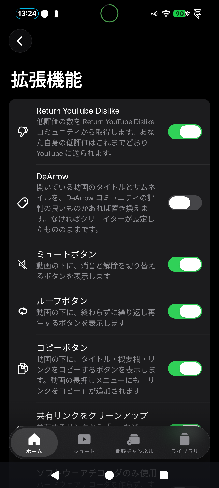
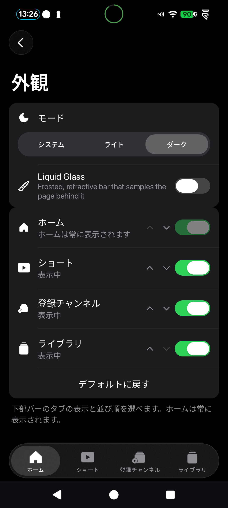

# Fork notes: enhancements

Notes on the changes this fork adds on top of upstream Yuno, written from the actual diff and the verification run.

## Overview

The fork adds six user-facing things: a content-language setting that makes YouTube answer in the app's language (Japanese verified on a device), multi-account Google sign-in with brand channels, an **Enhancements** settings page that gathers community extras (Return YouTube Dislike, DeArrow, mute / loop / copy buttons, link sanitizing) and a per-codec decoder policy, a reorderable bottom tab bar, empty states for feeds that load with no videos, and a bot check that recovers by itself. The goal is to make the player feel native in Japanese and to expose community features YouTube itself does not offer, without touching upstream's identity, licensing or release flow.

## How it works

One commit per feature, all on `feat/enhancements`:

- **`529497f` feat: ask YouTube in the app's language** — new `ContentLanguage.kt` carries `hl`/`gl` through the InnerTube requests, so YouTube answers with localized strings that the existing parsers read unchanged. `YouTube.kt` parses the localized counts and ages, and `UiKit.kt` formats counts, likes and ages per locale (Japanese 万/億 handling, `JapaneseParseTest.kt` covers the parse). The picker lives in Settings › Language › YouTube content (`ContentLanguageBody` in `Settings.kt`).
- **`2df371f` feat: support multiple Google accounts and brand channels** — `Account.kt` keeps several Google cookie sessions side by side (each AES-GCM encrypted as before), switches the active one, and lets an account act as one of the brand channels it manages. `Settings.kt` renders the accounts page (Google accounts, Add account, Channels: personal / brand). A subtitle without a handle now shows its fallback name instead of a literal "null".
- **`e0d6cfd` feat: add the Enhancements page** — new `Enhancers.kt` (toggles + `Enhancers.link()` tracking-parameter stripping, plus the Return YouTube Dislike and DeArrow clients) and new `Codecs.kt` (`CodecSettings`: disable a codec entirely, run decoders software-only, or use the synchronous MediaCodec adapter). `Settings.kt` gets the Enhancements page; `PlayerState.kt` persists mute/loop, `PlayerUi.kt` draws the mute, loop and copy pills and the dislike count, `Sheets.kt` copies links via the clipboard, `YouTube.kt` filters stream candidates through the codec policy before quality picks one, `PlaybackService.kt` falls back to sound when every video codec is off, and `AvSync.kt` holds the synchronous adapter path. A debug-only `DecoderTestActivity` exercises every MediaCodec on the device.
- **`a95bed7` feat: let the bottom bar's tabs be reordered, hidden and shown** — new `NavTabs.kt` stores the tab order and hidden set as one string in the "playback" preferences (`Home,-Shorts,Subscriptions,Library` style); `shown()` also drops Shorts while its master switch is off. `Settings.kt` edits both under Appearance › Tab bar, and `MainActivity.kt`, `NavBar.kt`, `GlassNav.kt` and `Rail.kt` all follow it. `Tab` carries its label as a resource so the bar reads in the app's language.
- **`39d09ab` fix: show empty feeds with an empty state and guest picks** — `Feeds.kt` shows an empty state with a retry when a feed loads with no videos, and a signed-in Home that comes back empty falls back to the guest recommendations for the session (stuck, undone by a feed/account reset, so the fallback keeps paging itself).
- **`a6cf3c9` fix: wait out YouTube's bot check and recover on its own** — new `BotCheckRecovery.kt` keeps quietly re-loading a refused video after the quick retries give up (`BotCheck`: 3 s / 8 s / 20 s and then either a 360p fallback or the error panel): stretches of 30 s / 60 s / 120 s / 240 s, and again the moment the default network changes — the check rides on the address, which is what the panel's airplane-mode hint is about. When a background load finally comes back with the real streams, `PlayerState.onBotCheckRecovered` opens the video stuck on the error panel again (the cache now holds the real streams), and the service's `StreamRecoverer.onRecovered` swaps a playing 360p fallback's source in place, at the same position. A wait that runs out its tries re-arms once more on the next network change (for ten minutes), so the toggle the panel suggests keeps working by itself. `VideoView`'s error panel states the auto-retry under the hint and adds an airplane-mode settings button; the loading spinner's bot-check note is localized now.

## Technical challenges

- Making YouTube actually answer in Japanese was a request problem, not a string problem: the `hl`/`gl` parameters had to ride every InnerTube call, and a few parsers assumed English digits and "views"/"ago" words. Counts and ages now go through a locale-aware parser with an ICU-based fallback (`JapaneseParseTest`).
- Splitting six features into honest per-feature commits over one working tree: every commit was built on its own (`git stash push --keep-index -u` → `compileDebugKotlin` → commit → pop), and shared files (`YouTube.kt`, `UiKit.kt`, `Settings.kt`, `YunoApplication.kt`, the string tables) were staged hunk by hunk so no commit referenced a later feature's code.
- The codec policy had to stay out of the stream-picking logic: it filters candidates before `QualityPreference.height` chooses, and the audio path degrades to sound-only when every video codec is disabled instead of erroring.
- The empty-feed fallback had to be "stuck" for the session on purpose — otherwise the fallback's own "load more" would page the signed-in Home again and flip-flop between sources.
- The recovery loop had to stay honest about what it knows: `StreamCache` never keeps a refused load as its answer, so a background load that returns is always the real thing — but a load that fails for any other reason (a network still coming up, a dead connection) must not end the wait. Every wait gives the network a three-second settle after a change, and reports a failed load's type and message inline, because release logs don't always carry a stack trace.
- Backing out of the app to toggle airplane mode freezes a background process (Android's cached-app freezer), so the waits and the network callback idle through it and pick up the moment the app is foreground again — verified on device: the recovery fired right after returning.

## Testing

- **Unit tests**: `./gradlew testDebugUnitTest --rerun` — **76 tests, 0 failed, 0 skipped** (`app/build/test-results/testDebugUnitTest/`). New classes: `JapaneseParseTest` (5), `EnhancersTest` (4), `CodecSettingsTest` (4), `NavTabsTest` (7).
- **Release build**: `./gradlew assembleRelease` — BUILD SUCCESSFUL (≈3 m 30 s), R8-shrunk, debug-signed per the README's own instructions.
- **Device E2E** (physical Samsung phone, Android user 11, 1080×2400; installed with `adb install -r --user 11 app-release.apk`, then `am start -n com.yuno/.MainActivity`):
  1. Home: feed rows, tab bar and mini-player all in Japanese (e.g. "1.3億 回視聴 · 2 年前").
  2. Settings › Account row: "テストユーザー / Google でログイン中 · 完全同期" — the account subtitle no longer reads "null".
  3. Settings › Enhancements: all toggles render (RYD / DeArrow / mute / loop / copy / sanitize on by default, sync off), scrolling shows the codec policy rows (software decoders, synchronous adapter, disable AVC / HEVC / VP9).
  4. Settings › Appearance › Tab bar: the reorder / show / hide group with "Reset to default".
  5. Settings › Language: the YouTube-content group lists "アプリの言語に合わせる(日本語)" selected under the app-language list.
  6. Account page: the GOOGLE ACCOUNT card and the CHANNELS group with "個人チャンネル" (personal channel) — personal information, so this screen was not used for docs.
  7. Player: the stats line in Japanese, the like pill showing a dislike count from Return YouTube Dislike ("2.8万"), and the mute / loop / copy pills; tapping copy opens the copy menu, "リンクをコピー" copies and shows the "コピーしました" toast.
- **Bot-check E2E** (second run, the same device — the check was live for most of it, so the whole path was exercised on real refusals):
  1. Opening videos refused one after another ("bot check on ANDROID …; VISIONOS said LOGIN_REQUIRED too"), and the quick retries gave up: the error panel showed the auto-retry note and the airplane-mode button, which opened Android's airplane-mode page.
  2. Toggling airplane mode off and back made the background wait retry right away (its stretches shortened); a toggle while the wait was still in Settings froze the process, and the retry fired on returning to the app — the freezer doesn't lose the wake-up.
  3. After the four stretches ran out, the log read "the waiting gave up (a network change tries again)"; the next airplane-mode toggle re-armed the wait, and this time the check passed: "bot check for O4xR47Yxafg passed in the background" → "opening it again" → the panel replaced itself with the video playing real streams (`adaptive video 144/240/360/480/720/1080p + audio itag 140`).
  4. With the check lifted, the same video that was refused all through the first run (TSx7yiAu3l8) opened normally on the final build.
- All screenshots were taken with `adb exec-out screencap -p` during this run; the two used in docs are privacy-checked (no account name, email or avatar).

## Limitations

- The empty-feed path was **not reproducible on the test device** (its account has subscriptions), so the empty state is verified by the unit tests and the code path; it was not exercised end-to-end on hardware.
- Return YouTube Dislike and DeArrow depend on their community endpoints; when unreachable the like pill simply shows no count and thumbnails/titles stay as YouTube sent them.
- DeArrow, software-only decoders, the synchronous adapter and the Enhancers sync toggle are off by default; only RYD, mute, loop, copy and link sanitizing are on.
- The bot-check recovery can only be exercised when YouTube actually runs the check: the success path was verified once on device (a re-armed wait passed and the video opened itself), but whether and when the check lifts stays with YouTube — no code can force it, and a video whose check never lifts keeps its 360p fallback or its panel with the manual buttons.
- While the app is backgrounded, Android's cached-app freezer idles the recovery waits (they resume when the app is back, verified on device), and an attempt that fires while the network is still coming up can burn one stretch on a connection error; the three-second settle after a network change narrows that window.
- Only the Japanese localization was verified on device; the other languages ride the same code path.
- This fork distributes no APK and changes no `versionName` / `versionCode` or self-update source; it stays one branch ahead of upstream.

## Base

Based on upstream commit `5f4648ae1dfcca49de82c3320a73151c76175cd1` (`git merge-base HEAD upstream/main`), the current tip of `danielkanan/Yuno`'s `main`.
